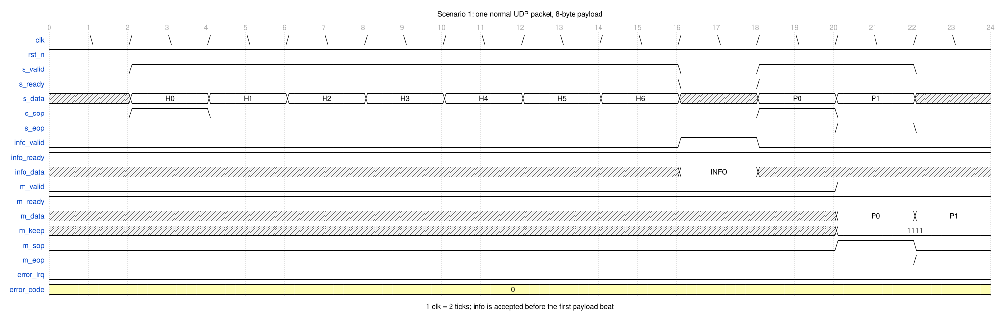
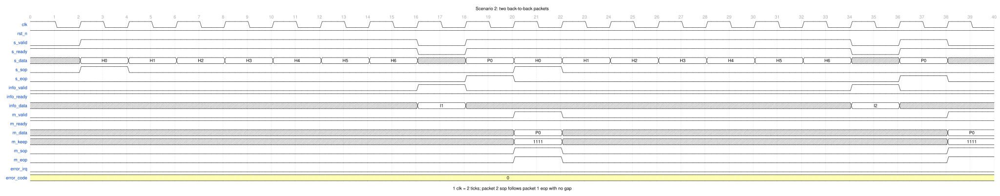
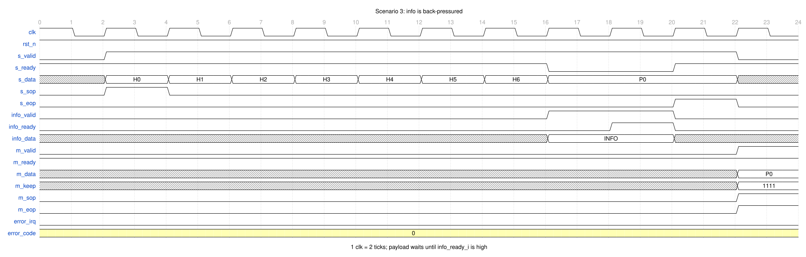
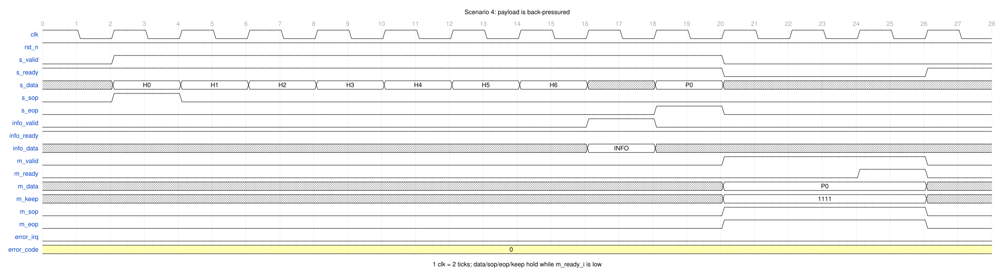
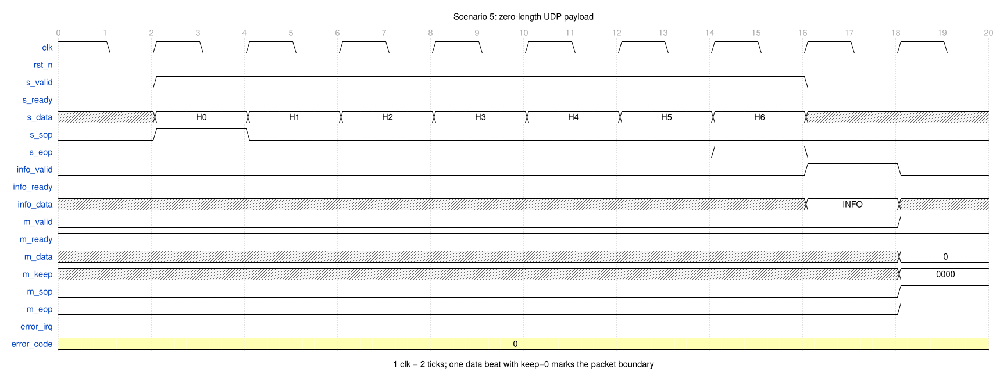
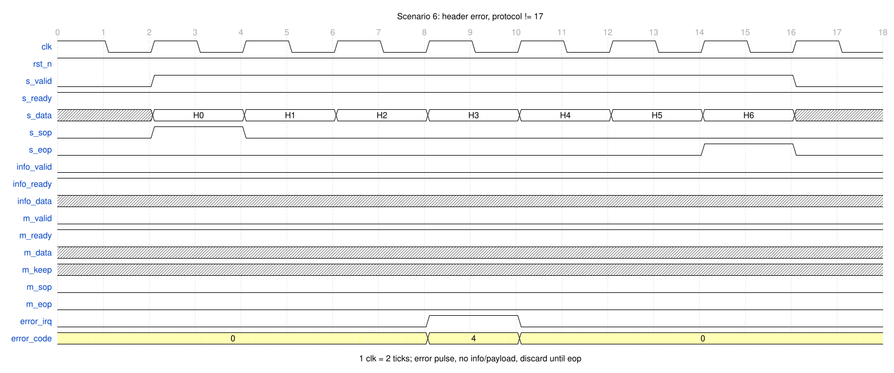
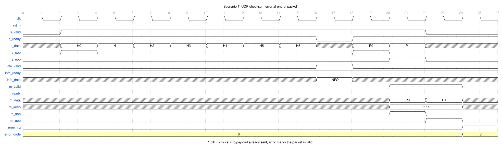
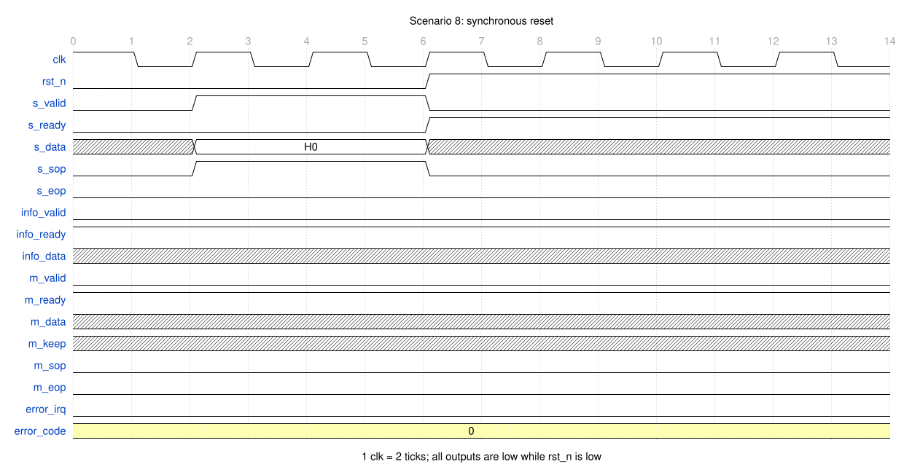
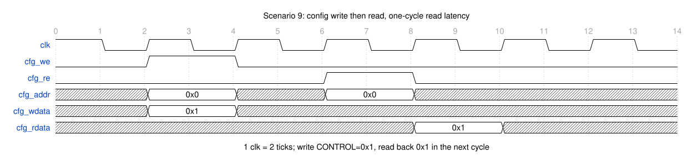
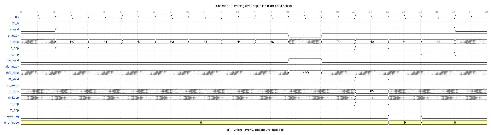

# REQ-002 IPv4/UDP 报文解析

## 背景与目标

网络设备收到 IPv4 报文后，需要把 UDP payload 交给下游，同时把 IP/UDP 头字段作为元数据送出。软件逐包解析会占用 CPU，也难以维持线速。本功能点提供一个 cut-through 的 IPv4/UDP 解析器：输入连续的 IPv4 包，输出 UDP payload 和头部信息，并在报文非法时通过错误脉冲上报。解析器不缓存整包，也不做转发决策。

## 功能描述

- F1: 输入 `s_data_i` 是 32-bit 字流。`s_sop_i` 标记 IP 包首字，`s_eop_i` 标记 IP 包末字。`s_data_i[7:0]` 是线序第一个字节，`s_data_i[15:8]` 是第二个字节，`s_data_i[23:16]` 是第三个，`s_data_i[31:24]` 是第四个。
- F2: 解析器按 IPv4 固定头（20 字节）和 UDP 头（8 字节）解析。只接受 version=4、IHL=5、MF=0、fragment offset=0、protocol=17 的包。
- F3: 合法包的 UDP payload 从 IP 包第 29 个字节开始（从 1 计数），长度等于 UDP length − 8。
- F4: 每个合法包输出一拍 `info_data_o`，字段见「硬件接口」的 info 字段表。info 在 payload 之前握手。
- F5: payload 以 32-bit 拍输出。首字节放 `m_data_o[7:0]`，第二个放 `m_data_o[15:8]`，第三个放 `m_data_o[23:16]`，第四个放 `m_data_o[31:24]`。末拍用 `m_keep_o` 标出有效字节。
- F6: payload 长度为 0 时，仍输出一拍 `m_valid_o=1`、`m_keep_o=4'b0000`、`m_sop_o=1`、`m_eop_o=1` 的 data。
- F7: `m_sop_o` 标 payload 首拍，`m_eop_o` 标 payload 末拍。非零 payload 的 sop 在首拍、eop 在末拍；payload 不超过 4 字节时二者同拍。
- F8: UDP length 小于 8，或大于 IP total length − 20 时，报 UDP 长度错误。该包不输出 info 和 payload。
- F9: IP total length 小于 28 时，报 IP 长度错误。该包不输出 info 和 payload。
- F10: 设 sop 到 eop（含两端）一共接收了 N 个 32-bit 字，则 IP total length 必须满足 `4×(N−1) < total_len ≤ 4×N`。不满足时在 eop 时报 IP 长度错误；已输出的 info/payload 由 error 脉冲标记为无效。
- F11: IP total length 大于 UDP length + 8 时，UDP payload 之后的字节照常接收，但不输出。
- F12: IPv4 头校验和与 UDP 校验和分别由 `CONTROL.IP_CSUM_EN`、`CONTROL.UDP_CSUM_EN` 控制。使能时校验失败报错；UDP checksum=0 表示发送端未计算，不报错。
- F13: 两个校验使能在包首采样，整包使用同一份配置。
- F14: 每个错误包最多产生一个 `error_irq_o` 单周期脉冲，`error_code_o` 在脉冲期间给出错误码。同一个包有多个错误时，报最先发现的错误；同一拍发现多个错误时，取错误码较小的那个。
- F15: 头阶段发现的错误不输出 info 和 payload。包尾或帧中途发现的错误可能已有部分输出，错误脉冲标记整包无效。
- F16: sop/eop 帧错误（包中途出现 sop，或 idle 时出现不带 sop 的字）报帧错误，并丢弃到下一个 eop。已经因其他错误进入丢弃状态的包，不再产生第二个错误脉冲。
- F17: 错误脉冲同时更新 `STATUS.ERR_FLAG`、`STATUS.LAST_ERR_CODE` 和 `ERR_CNT`。
- F18: 复位后解析器回到 idle，所有输出清零，配置恢复默认值，计数器清零。

## 软硬件接口（SW–HW Interface）

**结论：有软件接口。** 解析器提供本地 memory-like 配置/状态寄存器端口 `cfg_*`，系统集成时由总线桥接层映射到地址空间。桥接层、中断控制器和地址译码不在本功能点范围内。寄存器表由 ③ 的 `REGMAP-iup-001` 固化。

| 地址 | 名称 | 属性 | 复位值 | 字段 |
|---|---|---|---|---|
| `0x0` | `CONTROL` | RW | `0x0000_0003` | `[0]` `IP_CSUM_EN`；`[1]` `UDP_CSUM_EN`；`[31:2]` 保留，读 0，写忽略 |
| `0x1` | `STATUS` | RO | `0x0000_0000` | `[0]` `ERR_FLAG`（粘滞）；`[3:1]` 保留，读 0；`[7:4]` `LAST_ERR_CODE`；`[31:8]` 保留，读 0 |
| `0x2` | `ERR_CNT` | RO | `0x0000_0000` | `[31:0]` 错误包计数，满后回绕 |
| `0x3` | `IRQ_CLR` | WO | `0x0000_0000` | `[0]` 写 1 清 `ERR_FLAG`；`[1]` 写 1 清 `ERR_CNT`；`[31:2]` 保留；读 0 |
| `0x4`~`0xF` | 保留 | RO | `0x0000_0000` | 读 0，写忽略 |

访问属性：

- 字地址 4 bit，共 16 个 32-bit 字；只支持 32-bit 整字访问，无字节使能。
- 写操作在下一个 `clk` 上升沿生效。读操作有 1 拍延迟，`cfg_rdata_o` 在 `cfg_re_i=1` 的下一拍有效。
- 无 wait state。`cfg_we_i` 与 `cfg_re_i` 不得同拍有效；同拍时写优先，`cfg_rdata_o` 返回 0。
- 配置在包首字采样，整包生效。配置写与包首同拍时，当前包使用写入前的值，下一个包首开始使用新值。
- `error_irq_o` 是单周期脉冲，可直接接中断控制器的边沿触发输入。需要电平中断时，用 `STATUS.ERR_FLAG`。
- 同一拍发生错误与清除时，错误优先：`ERR_FLAG` 保持 1；`ERR_CNT` 的清除无效，计数从当前值加 1。

## 硬件接口（HW Interface）

### 参数表

首版没有用户可配参数，以下为固定位宽常量。

| 参数 | 默认值 | 合法范围 | 含义 |
|---|---|---|---|
| `DATA_W` | 32 | 固定 32 | 输入/输出数据位宽 |
| `INFO_W` | 240 | 固定 240 | info 位宽 |
| `CFG_ADDR_W` | 4 | 固定 4 | 配置字地址宽度 |
| `CFG_DATA_W` | 32 | 固定 32 | 配置数据位宽 |

### 接口信息

| 端口 | 方向 | 位宽 | 时钟域 | 复位值 | 含义 |
|---|---|---|---|---|---|
| `clk` | in | 1 | — | — | 唯一时钟，上升沿采样 |
| `rst_n` | in | 1 | `clk` | — | 同步复位，低有效 |
| `s_valid_i` | in | 1 | `clk` | — | 输入字有效 |
| `s_ready_o` | out | 1 | `clk` | 0 | 输入字可接收 |
| `s_data_i` | in | 32 | `clk` | — | 输入 32-bit 字，`[7:0]` 为线序首字节 |
| `s_sop_i` | in | 1 | `clk` | — | 输入包首字 |
| `s_eop_i` | in | 1 | `clk` | — | 输入包末字 |
| `m_valid_o` | out | 1 | `clk` | 0 | 输出 payload 有效 |
| `m_ready_i` | in | 1 | `clk` | — | 下游可接收 payload |
| `m_data_o` | out | 32 | `clk` | 0 | payload 数据 |
| `m_keep_o` | out | 4 | `clk` | 0 | payload 字节有效，bit k 对应 `m_data_o[8k+7:8k]` |
| `m_sop_o` | out | 1 | `clk` | 0 | payload 首拍 |
| `m_eop_o` | out | 1 | `clk` | 0 | payload 末拍 |
| `info_valid_o` | out | 1 | `clk` | 0 | 头部信息有效 |
| `info_ready_i` | in | 1 | `clk` | — | 下游可接收 info |
| `info_data_o` | out | 240 | `clk` | 0 | 头部信息 |
| `error_irq_o` | out | 1 | `clk` | 0 | 错误脉冲，单周期 |
| `error_code_o` | out | 4 | `clk` | 0 | 错误码，`error_irq_o=1` 时有效 |
| `cfg_addr_i` | in | 4 | `clk` | — | 配置字地址 |
| `cfg_wdata_i` | in | 32 | `clk` | — | 配置写数据 |
| `cfg_we_i` | in | 1 | `clk` | — | 配置写使能 |
| `cfg_re_i` | in | 1 | `clk` | — | 配置读使能 |
| `cfg_rdata_o` | out | 32 | `clk` | 0 | 配置读数据 |

`info_data_o` 使用扁平位段，字段为数值本身，不做字节交换。

| 位段 | 字段 | 位宽 | 含义 |
|---|---|---|---|
| `[239:236]` | `version` | 4 | IPv4 版本，合法包固定为 4 |
| `[235:232]` | `ihl` | 4 | IPv4 头长度（32-bit 字），合法包固定为 5 |
| `[231:224]` | `tos` | 8 | 服务类型 |
| `[223:208]` | `total_len` | 16 | IPv4 总长度（字节） |
| `[207:192]` | `id` | 16 | IPv4 标识 |
| `[191:189]` | `flags` | 3 | IPv4 标志位，bit2=保留，bit1=DF，bit0=MF |
| `[188:176]` | `frag_offset` | 13 | 分片偏移 |
| `[175:168]` | `ttl` | 8 | 生存时间 |
| `[167:160]` | `protocol` | 8 | 上层协议，合法包固定为 17 |
| `[159:144]` | `header_checksum` | 16 | IPv4 头校验和，按接收值输出 |
| `[143:112]` | `src_ip` | 32 | 源 IPv4 地址 |
| `[111:80]` | `dst_ip` | 32 | 目的 IPv4 地址 |
| `[79:64]` | `src_port` | 16 | UDP 源端口 |
| `[63:48]` | `dst_port` | 16 | UDP 目的端口 |
| `[47:32]` | `udp_len` | 16 | UDP 长度（字节） |
| `[31:16]` | `udp_checksum` | 16 | UDP 校验和，按接收值输出 |
| `[15:0]` | `payload_len` | 16 | UDP payload 长度，等于 `udp_len - 8` |

### 接口协议

**输入侧。** `s_valid_i` 与 `s_ready_o` 完成握手，`s_valid_i=1 && s_ready_o=1` 的 `clk` 上升沿接收一个 32-bit 字。`s_valid_i` 一旦拉高，`s_data_i`、`s_sop_i`、`s_eop_i` 必须保持到该字被接收。输入包按 32-bit 字对齐，`s_sop_i` 只在包首字为 1，`s_eop_i` 只在包末字为 1。包可以背靠背，不要求包间空拍。输入从 IPv4 头第一个字节开始，不含 Ethernet、VLAN 或 PPP 头。

**输出侧。** `m_valid_o` 与 `m_ready_i` 完成 payload 握手。`m_data_o`、`m_keep_o`、`m_sop_o`、`m_eop_o` 在 `m_valid_o=1 && m_ready_i=0` 期间保持不变。`m_keep_o` 只允许 `4'b0000`、`4'b0001`、`4'b0011`、`4'b0111`、`4'b1111` 五种值。非零 payload 的每个 data 拍 `m_keep_o` 非 0；零 payload 的唯一 data 拍 `m_keep_o=4'b0000`。

**握手与流控。** 输入、info、payload 三组通道各自使用 valid/ready 握手。valid 一旦拉高，必须保持到 ready；valid 与 ready 同拍为一次传输。info 未被接收时，payload 不开始；payload 未被接收时，输入暂停。error 没有 ready，不反压任何通道，接收方必须自己锁存这个单周期脉冲。

**info 通道。** `info_valid_o` 与 `info_ready_i` 完成 info 握手，每个合法包一拍。info 必须在 payload 首拍之前被接收；info 未被接收时，`m_valid_o` 保持 0，解析器也不接收新的 payload 字。info 被接收后，info 通道不再反压 payload，payload 只受 `m_ready_i` 控制。info 与 payload 的包顺序一致：包 N 的 info 在包 N 的 payload 之前，包 N+1 的 info 在包 N 的 payload 之后。

**error 输出。** `error_irq_o` 是单周期脉冲，没有 ready，可以在任意时刻拉高，包括 payload 正在传输或反压期间。`error_code_o` 在 `error_irq_o=1` 时给出错误码，其余时刻为 0。错误码定义：

| 码 | 名称 | 触发条件 | 输出表现 |
|---|---|---|---|
| 0 | `NONE` | 无错误 | 无脉冲 |
| 1 | `IP_VER` | version ≠ 4 | 不输出 info/payload |
| 2 | `IP_IHL` | IHL ≠ 5 | 不输出 info/payload |
| 3 | `IP_FRAG` | MF=1 或 fragment offset ≠ 0 | 不输出 info/payload |
| 4 | `IP_PROTO` | protocol ≠ 17 | 不输出 info/payload |
| 5 | `IP_LEN` | total length < 28；或 total length 与 sop/eop 字数不符 | 前者不输出；后者可能已输出 |
| 6 | `UDP_LEN` | UDP length < 8；或 UDP length > total length − 20 | 不输出 info/payload |
| 7 | `IP_CSUM` | IPv4 头校验和错误 | 不输出 info/payload |
| 8 | `UDP_CSUM` | UDP 校验和错误 | 可能已输出，用 error 标记 |
| 9 | `FRAME` | 包中途出现 sop；或 idle 时出现不带 sop 的字 | 可能已输出，用 error 标记 |
| 10~15 | 保留 | — | — |

**配置访问。** `cfg_*` 与 `clk` 同步。`cfg_we_i=1` 时，`cfg_wdata_i` 在下一个 `clk` 上升沿写入 `cfg_addr_i` 指向的寄存器。`cfg_re_i=1` 时，`cfg_rdata_o` 在下一拍给出读数据。`cfg_we_i` 与 `cfg_re_i` 不得同拍有效。未映射地址读 0，写忽略。

**复位。** `rst_n` 同步、低有效。断言期间 `s_ready_o`、`m_valid_o`、`m_sop_o`、`m_eop_o`、`info_valid_o`、`error_irq_o`、`error_code_o`、`cfg_rdata_o` 全部为 0；`CONTROL` 恢复 `0x0000_0003`，`STATUS` 和 `ERR_CNT` 清零。复位释放后解析器从 idle 开始，等待 `s_sop_i=1` 的字。

**时钟。** 单时钟域。所有输入在 `clk` 上升沿采样，所有输出以 `clk` 上升沿为基准。无跨时钟域处理、无异步复位、无时钟门控。

**接口不变式**（对任意输入都成立，供 ⑤ 写断言）：

| 编号 | 不变式 |
|---|---|
| I1 | `rst_n=0` 时，所有 valid、sop、eop、error_irq 为 0，`cfg_rdata_o=0` |
| I2 | `s_valid_i=1 && s_ready_o=0` 期间，`s_data_i`、`s_sop_i`、`s_eop_i` 保持不变 |
| I3 | `m_valid_o=1 && m_ready_i=0` 期间，`m_data_o`、`m_keep_o`、`m_sop_o`、`m_eop_o` 保持不变 |
| I4 | `info_valid_o=1 && info_ready_i=0` 期间，`info_data_o` 保持不变 |
| I5 | `m_sop_o` 和 `m_eop_o` 只在 `m_valid_o=1` 时为 1 |
| I6 | 未出错的包，data 序列恰好有一个 sop 和一个 eop，且 sop 不晚于 eop |
| I7 | `m_keep_o` 只取 `0`、`1`、`3`、`7`、`15`；非零 payload 的 data 拍 keep 非 0，零 payload 的唯一 data 拍 keep=0 |
| I8 | info 未被接收时 `m_valid_o=0`；每个合法包的 info 在首个 data 拍之前被接收 |
| I9 | `error_irq_o` 是单周期脉冲；`error_irq_o=1` 时 `error_code_o` 为 1~9，其余时刻为 0 |
| I10 | `cfg_rdata_o` 在 `cfg_re_i=1` 的下一拍有效；`cfg_we_i` 与 `cfg_re_i` 不同时有效 |
| I11 | `s_sop_i` 只在包首字为 1，`s_eop_i` 只在包末字为 1；包按 32-bit 字对齐 |
| I12 | 配置在包首采样，整包生效；包中途写 `CONTROL` 不改变当前包的校验行为 |

以下场景只画接口信号，不画内部状态。每个 `clk` 周期等于 2 个 tick。

#### 场景 1：单个正常包（8 字节 payload）

**文字说明**：输入 7 个头字后，解析器先握手 info，再接收 payload 字。payload 输出 2 拍，首拍 `m_sop_o=1`，末拍 `m_eop_o=1`，两拍 `m_keep_o=4'b1111`。info 在 payload 首拍之前被接收。

#### 场景 2：背靠背两个包

**文字说明**：包 1 的 `s_eop_i` 之后下一拍就是包 2 的 `s_sop_i`。包 1 的 info 和 payload 先输出，包 2 的 info 排在包 1 的 payload 之后。两个包各自有独立的 sop/eop。

#### 场景 3：info 反压

**文字说明**：头解析完成后 `info_valid_o=1`，但 `info_ready_i=0`。解析器保持 info 和 `info_data_o` 不变，`s_ready_o=0`，`m_valid_o=0`。`info_ready_i` 拉高、info 被接收后，payload 才开始输出。

#### 场景 4：payload 反压

**文字说明**：`m_valid_o=1` 后 `m_ready_i=0`。解析器保持 `m_data_o`、`m_keep_o`、`m_sop_o`、`m_eop_o` 不变，同时拉低 `s_ready_o`，输入暂停。`m_ready_i` 恢复后当前拍被接收，解析器继续。

#### 场景 5：零长度 payload

**文字说明**：UDP length=8，info 的 `payload_len=0`。data 通道仍输出一拍：`m_valid_o=1`、`m_keep_o=4'b0000`、`m_sop_o=1`、`m_eop_o=1`。这一拍不携带 payload 字节，只用于标出包边界。

#### 场景 6：头阶段错误（protocol ≠ 17）

**文字说明**：第 3 个字发现 protocol ≠ 17，`error_irq_o` 拉高一拍，`error_code_o=4`。该包不输出 info 和 payload。解析器继续接收并丢弃到 `s_eop_i`，然后回到 idle。

#### 场景 7：UDP 校验和错误（包尾报错）

**文字说明**：info 和 payload 正常输出。最后一个 payload 拍接收后，`error_irq_o` 拉高一拍，`error_code_o=8`。下游必须用这个脉冲把本包已收到的 info 和 payload 作废。

#### 场景 8：复位

**文字说明**：`rst_n=0` 期间，即使 `s_valid_i=1`，`s_ready_o`、`m_valid_o`、`info_valid_o`、`error_irq_o` 都为 0。`rst_n` 释放后解析器从 idle 开始，等待 sop。

#### 场景 9：配置写与读

**文字说明**：`cfg_we_i=1` 写 `CONTROL=0x1`，关闭 IP 头校验、打开 UDP 校验。写在下个 `clk` 沿生效。随后 `cfg_re_i=1` 读同一地址，`cfg_rdata_o` 在下一拍返回 `0x1`。配置只影响之后开始的包。

#### 场景 10：帧错误（包中途 sop）

**文字说明**：包 1 还没有 `s_eop_i`，输入又出现 `s_sop_i`。解析器拉高 `error_irq_o` 一拍，`error_code_o=9`，并丢弃到下一个 `s_eop_i`。包 1 已输出的 info/payload 由 error 标记作废。

## 约束

| 类别 | 约束 | 来源 |
|---|---|---|
| 面积 | 首版不设面积门限；⑥ 记录 sky130 `sky130_fd_sc_hd__tt_025C_1v80` 的实测 cells，owner：⑥ 检查汇总 | 本功能点 |
| 功耗 | 首版不设功耗门限；校验关闭时不计算校验和，owner：⑥ 检查汇总 | 本功能点 |
| 时序 | 目标时钟 100 MHz（周期 10 ns），单周期同步设计；稳态吞吐 1 个 32-bit 字/拍，info 握手和反压会插入空拍 | 本功能点 |
| 工艺 | sky130 | 项目约定 |
| 包长 | 支持 IPv4 total length 28~65535 字节的 UDP 包；更短的包按错误处理。不缓存整包，包长不增加存储开销 | 本功能点 |
| 其它 | RTL 必须能通过 Yosys + `sky130_fd_sc_hd` 综合；不使用不可综合结构 | 流程约定 |

## 不做的事（non-goals）

- 不解析 IPv6、ARP、ICMP、TCP；protocol ≠ 17 的包报错丢弃。
- 不支持 IPv4 options；IHL ≠ 5 的包报错丢弃。
- 不支持分片重组；MF=1 或 fragment offset ≠ 0 的包报错丢弃。
- 不缓存整包，不做 store-and-forward；UDP 校验和错误在包尾用 error 脉冲标记，不撤回已输出的字节。
- 不做跨包流水；同一时刻只有一个包在途，包 N 的 payload 结束后才开始包 N+1 的 info。
- 不做 UDP 端口过滤、五元组匹配、转发决策或会话表。
- 不做 Ethernet、VLAN、PPPoE 解析；输入必须从 IPv4 头第一个字节开始。
- 不实现 APB/AXI-Lite 从接口；`cfg_*` 只是本地 memory-like 寄存器端口，桥接和地址映射由系统集成完成。
- 不做跨时钟域、异步复位、时钟门控或低功耗状态机。
- 不做按错误码分类的计数器；只保留总错误包数、最近错误码和粘滞错误标志。

## 变更历史

| 日期 | 变更 | 影响的上游/下游 |
|---|---|---|
| 2026-10-28 | 初稿：确定 IPv4-only、32-bit 数据、低字节在前、info 先于 payload、4-bit keep、双校验可配、memory-like 配置寄存器、sop/eop 定界、error 脉冲 + 状态/计数、零 payload 空拍 | ② 系统方案与 ③ 详细设计按本接口契约展开 |
